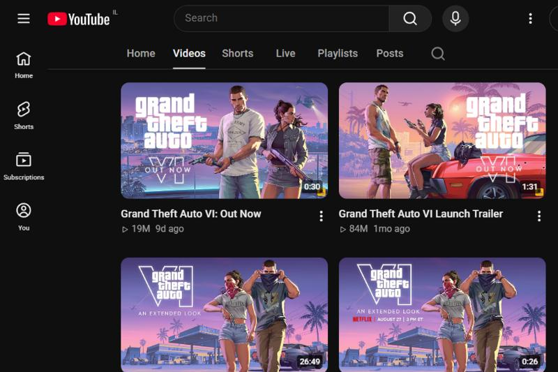
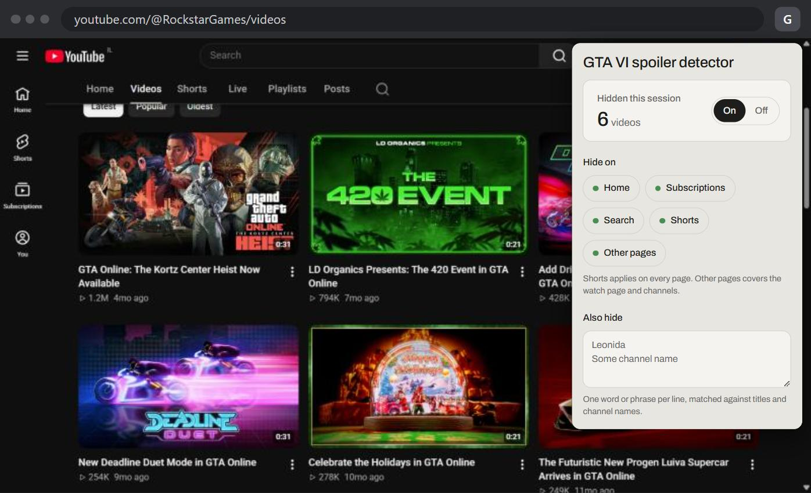
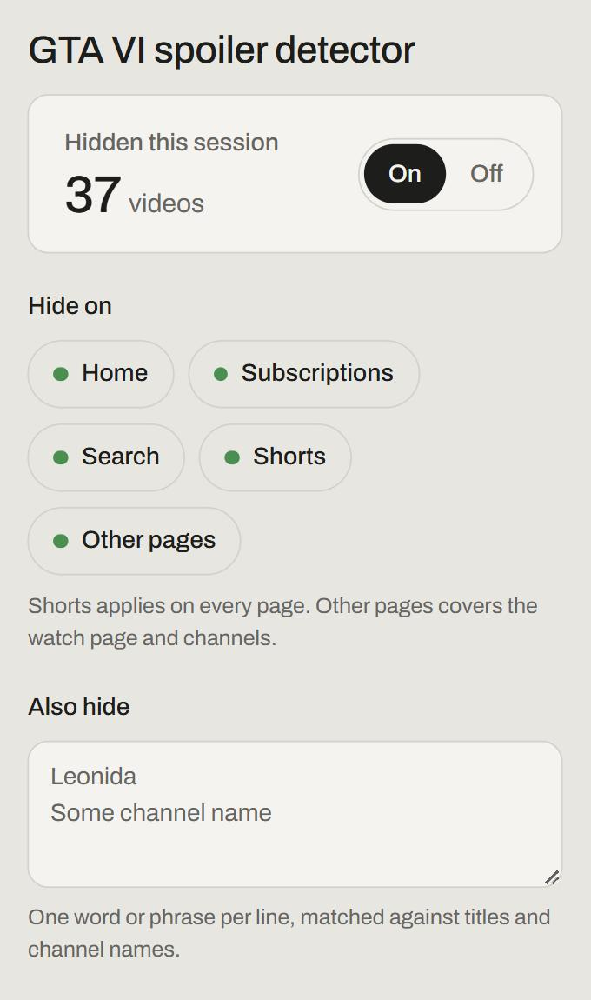
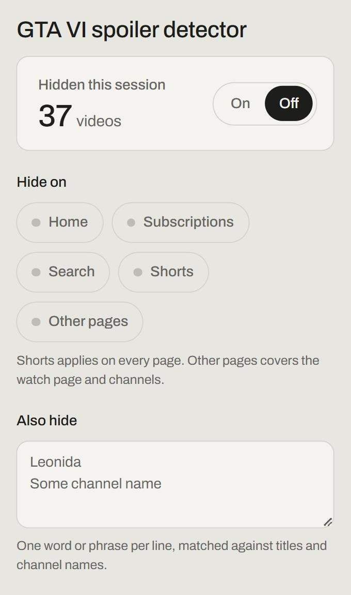

# GTA VI Spoiler Detector

A browser extension that hides GTA VI videos on YouTube, so you can keep using YouTube without the game
being spoiled. Videos about other GTA games stay where they are.

**Spoiler detector off**



**Spoiler detector on**



## The problem

GTA VI is out, and YouTube is full of it: story scenes, endings, "10 things the game doesn't tell you".
You do not have to search for any of it. It shows up on your home page, in your subscriptions and next to
whatever you are watching, with the spoiler written in the title and drawn on the thumbnail.

## How this fixes it

The extension reads the title and channel name of every video YouTube is about to show you. If they
mention GTA VI, the video is removed before it appears, and the videos around it close the gap, so the
page looks normal instead of full of holes.

- It catches `GTA 6`, `GTA VI`, `GTA6`, `Grand Theft Auto VI`, hashtags like `#gta6`, and Hebrew spellings.
- It leaves GTA V, GTA Online, Vice City and every other GTA game alone.
- It works on the home page, subscriptions, search, Shorts shelves, channel pages and the suggestions
  next to a video.

## Install

Download the zip for your browser from the
[latest release](https://github.com/NadavM-Eng/gta-vi-spoiler-detector/releases/latest).

### Chrome, Brave, Edge

1. Unzip the `chrome-brave-edge` file into a folder you will keep. The browser runs the extension from
   that folder.
2. Open `chrome://extensions` (in Brave `brave://extensions`, in Edge `edge://extensions`).
3. Turn on **Developer mode**.
4. Click **Load unpacked** and choose the unzipped folder.
5. Reload any YouTube tabs that were already open.

### Firefox

1. Open `about:debugging#/runtime/this-firefox`.
2. Click **Load Temporary Add-on** and choose the `firefox` zip file.
3. Reload any YouTube tabs that were already open.

Firefox removes temporary add-ons when it closes, so this has to be repeated after a restart. A
permanent install needs the add-on to be signed by Mozilla, which has not been done yet. The Firefox
version needs Firefox 127 or newer and has not been tested as thoroughly as the Chrome one, so please
open an issue if something is off.

## Using it

Click the extension's icon in the toolbar.

| On | Off |
|---|---|
|  |  |

- **On / Off** turns the whole thing on or off.
- **Hidden this session** counts the videos hidden since you opened the browser. Each video counts once.
- **Hide on** lets you choose where it works. Home, Subscriptions and Search cover regular videos on
  those pages. Shorts covers Shorts wherever they appear. Other pages covers the watch page and channels.
- **Also hide** takes extra words or channel names, one per line. Any video whose title or channel
  contains one of them is hidden too. Useful for character names or a channel that posts nothing else.

## What it does not catch

- A video with a harmless title and a spoiler in the thumbnail. The extension only reads text.
- The full-screen Shorts player, where you swipe from one Short to the next. Shorts shelves are covered.
- Comments, community posts and live chat.

A title such as "GTA V vs GTA VI" is hidden, because it mentions GTA VI.

## Privacy

The extension collects nothing and sends nothing anywhere. Your settings are kept in the browser's own
extension storage. It makes no network requests at all; even the popup's font is bundled inside it.

## For developers

How it works is described in [ARCHITECTURE.md](ARCHITECTURE.md).

```bash
node --test test/matcher.test.js test/background.test.js
```

```bash
node scripts/build.js
```

The first command runs the tests. The second builds both zip files into `dist/`. Neither needs any
dependencies.

## Licence

MIT. See [LICENSE](LICENSE). The bundled Archivo font is under the SIL Open Font License, in
[popup/fonts/OFL.txt](popup/fonts/OFL.txt).

Not affiliated with Rockstar Games, Take-Two Interactive or YouTube.
